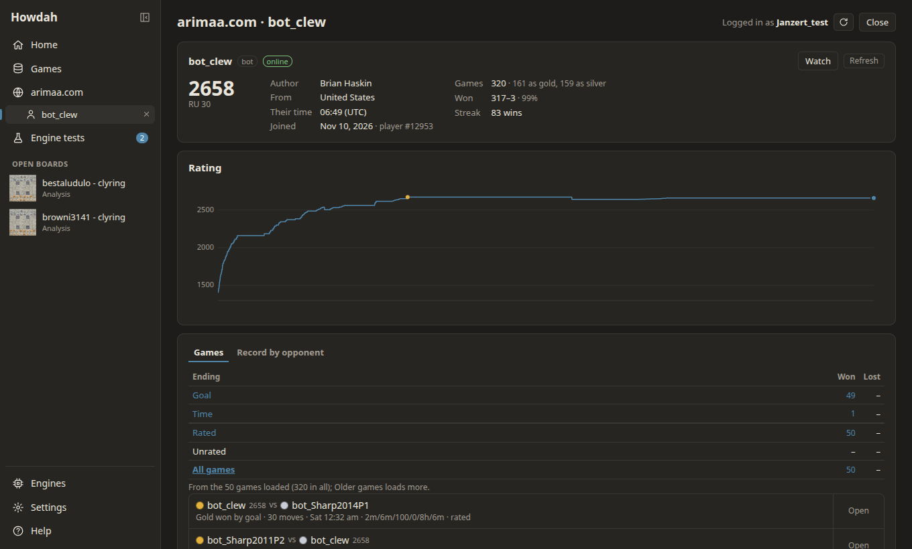
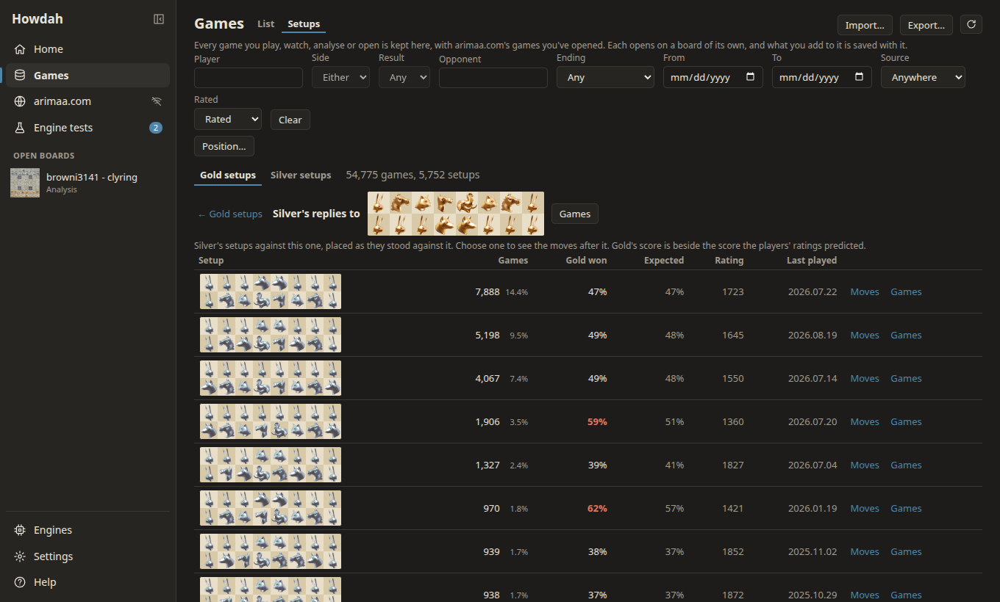
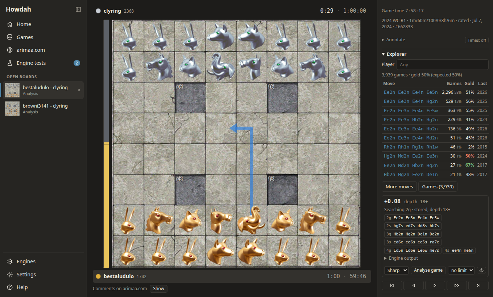
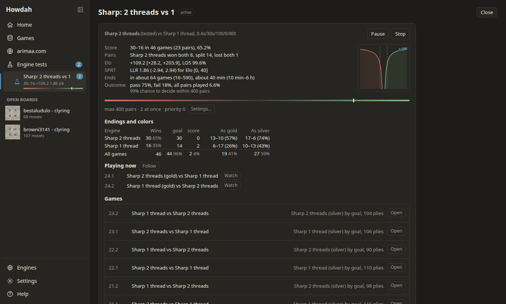

# Howdah 

[](https://github.com/Janzert/howdah/actions/workflows/ci.yml)

Howdah is a desktop app for playing and studying
[Arimaa](https://en.wikipedia.org/wiki/Arimaa). Play, watch and chat on
[arimaa.com](http://arimaa.com/), play against engines on your own
computer, analyse games and positions, and search arimaa.com's whole
game archive offline. It runs on Windows, Linux and macOS.


## Features

**arimaa.com**

- Play in the gameroom: create and join games, rated or unrated, live
  or postal, with invitations, chat and takebacks. See who's online and
  invite them, or start a game with one of the server's bots.
- Watch live games, or open finished ones with the comments people left
  on them.
- Players' pages: their rating through the years, their games and how
  they ended, and their record against each opponent.
- The gameroom's chat room and its archive, and its announcements.
- Solve arimaa.com's puzzles.
- Games carry on through network drops and the computer sleeping, and
  you can return to a game in progress.



**Play and review**

- The complete rules, including repetition and the one-minute setup
  allowance in timed games.
- Move pieces by dragging them along their route, with arrows on hover,
  or step by step with the mouse. Moves animate, and frozen pieces are
  marked.
- A move tree with variations, comments and move glyphs. Try a line
  anywhere in a game, and it's kept as a variation.
- Load and copy game records in the PGN-style Arimaa format. Going
  through a timed game shows the clocks at each move.
- Several games at once: each has a board in the main window, which can
  pop out into a window of its own and dock back.
- A position editor: set up any position, then analyse it, play from it
  or search for it.
- Clocks and time controls (fractions of a second too), sounds, board
  and piece themes, and light and dark colors.

**Analysis**

- An engine searches the position on the board as you move through a
  game, showing its evaluation (and its chance of winning, when it gives
  one), its best line drawn on the board, and its output. Click a line to
  add it to the game as a variation.
- *Analyse game* goes over a whole game in the time you give it, or until
  stopped. It marks the doubtful moves and the mistakes with the line the
  engine prefers, and draws the evaluation through the game as a graph
  under the board; click the graph to go to a move.
- What an engine finds is kept by position, so it shows again in any
  game reaching that position without the engine running.

**Game database**

- Every game you play, watch, open or analyse is kept, with its
  variations, comments and analysis, and can be found again by player
  (under any name they've had), opponent, side, result, ending, date,
  rated or not, and where it came from.
- arimaa.com's whole game archive (over 425,000 games) is one download
  from the Games panel, with small updates for the games added since. Its
  games then open at once, offline.
- A setup explorer: the setups gold and silver play, silver's replies to
  a setup, and the moves after them, each with how often it was played,
  how it scored, and what the players' ratings predicted.
- The board's Explorer: the moves played next from the position on the
  board, and the games that reached it.
- Position search, for an exact position or a pattern of pieces.
- Export games to share them, with or without your variations, comments,
  analysis and chat, and import someone else's: what you both added is
  joined.





**Engines**

- Play against an engine, or watch two engines play each other.
- [Sharp](https://github.com/Janzert/arimaasharp) and
  [OpFor](https://github.com/Janzert/OpFor) can be installed from the
  Engines panel with a click, and kept up to date there. Any other
  engine that speaks [AEI](https://github.com/Janzert/AEI) can be added
  by its program path or a manifest.
- Set an engine's options for every game, for one game, or for analysis.

**Engine tests**

- For engine developers: play two engines against each other in many
  games, several at once, until an SPRT decides whether a change is
  better, with a chart of how the test is going and how its games ended.
- Rate a pool of engines against each other, or tune an engine's options
  with SPSA. Games can start from a set of positions, and engines can
  ponder.
- Tests queue up and carry on after a restart, and each game can be
  followed live. `howdah-tourney` does the same from the command line.



## Install

Download the installer for your system from the
[latest release](https://github.com/Janzert/howdah/releases/latest):

| System | File |
| --- | --- |
| Windows 10 and 11 (x64) | `Howdah_<version>_x64-setup.exe`, or the `.msi` |
| macOS (Apple Silicon) | `Howdah_<version>_aarch64.dmg` |
| Linux (x86_64) | `.deb` (Debian, Ubuntu), `.rpm` (Fedora, RHEL), or `.AppImage` (any distribution) |

The installers aren't code signed yet, so your system will warn you the
first time you start Howdah:

- **Windows:** SmartScreen says it protected your PC. Click
  *More info*, then *Run anyway*.
- **macOS:** after macOS refuses to open it, open System Settings,
  go to *Privacy & Security*, and click *Open Anyway* next to Howdah.
  If macOS says the app is damaged, run
  `xattr -dr com.apple.quarantine /Applications/Howdah.app` in Terminal.
  (The macOS build is tested automatically but hasn't yet been tried by
  hand. Reports are welcome.)
- **Linux:** for the AppImage, make it executable first
  (`chmod +x Howdah_*.AppImage`) and then run it. It needs WebKitGTK 4.1
  (`libwebkit2gtk-4.1-0` on Debian and Ubuntu, `webkit2gtk4.1` on
  Fedora), which most desktops already have. The `.deb` and `.rpm`
  install it for you.

The release's `SHA256SUMS` file lists each download's SHA-256 digest if
you'd like to check it.

Howdah doesn't update itself, but it says on Home when a new version is
out (Settings can turn that off). The [releases page](https://github.com/Janzert/howdah/releases)
has new versions, and [CHANGELOG.md](CHANGELOG.md) what changed.

### Troubleshooting

- **Linux, blank window:** on some NVIDIA or Wayland setups, start it
  with `WEBKIT_DISABLE_DMABUF_RENDERER=1 howdah` (or put the variable in
  front of the AppImage).
- **Linux, no sound:** sound goes through GStreamer; install
  `gstreamer1.0-plugins-good` (Debian, Ubuntu) or
  `gstreamer1-plugins-good` (Fedora).

## Getting started

- **arimaa.com:** click *arimaa.com* in the sidebar and log in with your
  gameroom account to play, watch, chat or start games.
- **Play an engine:** install Sharp and OpFor from *Home* (or from
  *Engines*), then start a *New game* with an engine on one side.
- **Analyse:** on a board, turn on *Analysis* and pick an engine. It
  follows the position as you step through the game. *Analysis board*
  on *Home* starts from an empty one, and *Analyse game* beside the
  engine goes over the whole game.
- **Game archive:** *Games* in the sidebar offers arimaa.com's game
  archive as one download. Its *Setups* view is the setup explorer, and
  a board's *Explorer* (under the move list) shows the moves played from
  its position.
- **Records:** *Open record* on *Home* loads a game pasted in or opened
  from a file, and *Record* in a board's `⋯` menu gives its game's
  record to copy.
- Press `?` for the keyboard shortcuts.

## Building from source

Howdah is written in Rust with [Tauri 2](https://tauri.app/) and a
Svelte and TypeScript frontend.

### Prerequisites

- Rust (stable, 1.100+) and Node.js 22.12+ (or 24+) with npm.
- The platform packages Tauri needs:

**Linux**

Debian/Ubuntu:
```bash
sudo apt install libwebkit2gtk-4.1-dev build-essential curl wget file libxdo-dev libssl-dev libayatana-appindicator3-dev librsvg2-dev
```

Fedora: `sudo dnf install webkit2gtk4.1-devel openssl-devel libappindicator-gtk3-devel librsvg2-devel libxdo-devel`
plus `sudo dnf group install c-development`.

The app itself only strictly needs `libwebkit2gtk-4.1-dev` and a C
toolchain; the rest are for bundling.

**Windows**: Microsoft C++ Build Tools ("Desktop development with C++")
and WebView2, which ships with Windows 10/11.

**macOS**: Xcode Command Line Tools (`xcode-select --install`).

### Build and run

```bash
cd app
npm install
npm run tauri dev      # run the app with hot reload
npm run tauri build    # installers, in target/release/bundle/
```

For a package that brings its own updates (a Flatpak, a distribution's
package), build with `HOWDAH_NO_UPDATE_CHECK=1` in the environment: the
app then never asks GitHub for new releases, and Settings leaves the
option out. The AppStream metadata is in
`app/src-tauri/linux/io.github.janzert.howdah.metainfo.xml`.

Release installers also carry `howdah-tourney`, the engine test daemon:

```bash
npm run sidecar        # builds it into src-tauri/binaries/
npm run tauri build -- --config src-tauri/tauri.sidecar.conf.json
```

### Test

```bash
cargo test --workspace                   # Rust: rules, engines, gameroom client, app logic
cargo clippy --workspace --all-targets
cd app
npm run check                            # svelte-check / TypeScript
npm test                                 # vitest
npm run e2e                              # Playwright smoke tests (needs Chromium)
```

CI runs these on Linux, Windows and macOS and builds the installers.

### Layout

- `crates/howdah-arimaa`: rules, positions, notation, the game tree and
  game records. Pure Rust with no UI dependencies.
- `crates/howdah-aei`: an async AEI controller and engine-vs-engine matches.
- `crates/howdah-gameroom`: the arimaa.com gameroom client.
- `crates/howdah-db`: the game database (SQLite), its archive import,
  the setup explorer and position search, and sharing games.
- `crates/howdah-render`: draws a position as a PNG or JPEG with the
  classic themes (`cargo run -p howdah-render -- POSITION OUT.png`).
- `crates/howdah-tourney`: the engine test runner and its daemon.
- `packages/board`: the board, player bars, themes and sounds, as Svelte
  components shared with other sites.
- `app/`: the Tauri application. `src-tauri/` is the Rust shell and `src/`
  is the Svelte frontend.
- `docs/`: design notes (analysis, variations, engines, the gameroom, the
  game database, windows, result codes, engine tests and tournaments).

## Acknowledgements

The Howdah logo was made by Brian Haskin Jr. and Claude.

The classic board and piece images come from the original arimaa.com
client and have been released to the public domain. See
`packages/board/src/themes/classic/ATTRIBUTION.md`.

The sounds are made from samples in [Kenney](https://kenney.nl/)'s audio
packs (Interface Sounds, Casino Audio, Impact Sounds, Music Jingles, UI
Audio and Digital Audio), released under CC0. Thanks, Kenney! See
`packages/board/src/sounds/board/ATTRIBUTION.md` and
`packages/board/src/sounds/app/ATTRIBUTION.md` for which samples went into which
sound.

Finally, thanks to Omar Syed, not only for creating a great game but even
more for his decades of effort keeping [arimaa.com](http://arimaa.com/) alive
and working for players to enjoy.

## License

MIT; see [LICENSE](LICENSE).
